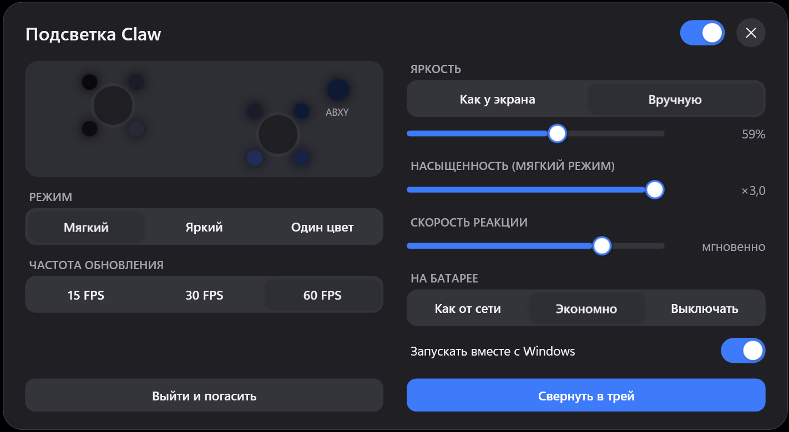
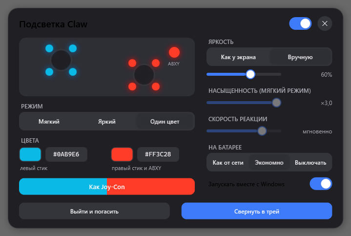
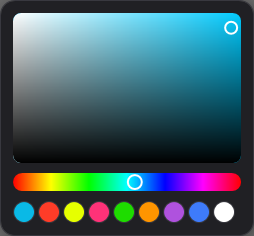

# Подсветка Claw 8 AI+ (ClawAmbilight)

Подсветка стиков и кнопок ABXY на **MSI Claw 8 AI+** по картинке на экране, как Ambilight у телевизоров.

## Совместимость

| Модель | Поколение | Статус |
|---|---|---|
| Claw 8 AI+ (A2VM, Intel Lunar Lake) | 2-е | проверено, прошивка контроллера 2.30+ |
| Claw 7 AI+ (A2VM, Intel Lunar Lake) | 2-е | скорее всего работает (та же платформа), не проверено |
| Claw A1M (Intel Meteor Lake) | 1-е | не поддерживается: другие адреса профиля подсветки |
| Claw A8 (AMD Ryzen Z2 Extreme) | 3-е | не поддерживается: другой контроллер и прошивка |

Если проверишь на другой модели, напиши в issues.

- **Подсветка по экрану:** каждая четверть экрана красит свою четверть кольца стика:
  левая половина экрана идёт на левый стик, правая на правый стик и ABXY.
  Два режима: **Мягкий** (спокойные, насыщенные цвета сцены) и **Яркий** (самый
  насыщенный акцент кадра: огонь, неон, магия).
- **Один цвет:** свой цвет для левого стика и для правого стика с ABXY, любой из 16 млн
  через пикер, кнопка **Как Joy-Con** (неоновые синий и красный, как у Nintendo Switch).
- **Яркость:** как у экрана (подсветка следует за подсветкой дисплея, ползунок задаёт
  потолок) или вручную.
- **Экономно:** экран захватывается через DXGI Desktop Duplication и уменьшается прямо на
  видеокарте, процессору достаётся картинка 60×37. Около 1.5% одного ядра, на статичной
  картинке почти 0%. Работает и в полноэкранных играх.
- **На батарее:** как от сети, экономно (10 FPS) или выключать. Подсветка гаснет на экране
  блокировки, при погашенном экране и при выходе из программы.
- Живёт в трее, ставится без прав администратора, автозапуск с Windows по желанию.



 

## Установка

Скачай `ClawAmbilight-Setup-<версия>.exe` из [Releases](../../releases) и запусти. Установщик
ставит программу в `%LOCALAPPDATA%\Programs\ClawAmbilight` без прав администратора, по желанию
включает автозапуск и ярлык на рабочем столе. Нужна среда .NET 10 Desktop Runtime: если её
нет, установщик сам скачает её с сайта Microsoft и поставит (только этот шаг попросит UAC).

Удаление обычное, через «Параметры → Приложения». Подсветка при этом гаснет, настройки в
`%APPDATA%\ClawAmbilight` остаются для следующей установки.

## Управление

- Клик по иконке в трее открывает настройки, правый клик даёт меню: вкл/выкл, режим, выход.
- `ClawAmbilight.exe --tray` запуск свёрнутым в трей, `--quit` корректный выход с выключением
  подсветки.
- Настройки лежат в `%APPDATA%\ClawAmbilight\settings.json` и подхватываются на лету, так что
  программой можно управлять из скриптов или голосового помощника:

```json
{ "enabled": true, "mode": "static", "staticLeft": "#0AB9E6", "staticRight": "#FF3C28",
  "brightnessSource": "display", "brightness": 100 }
```

`mode`: `ambient`, `vibrant`, `static`; `brightnessSource`: `display`, `manual`;
`onBattery`: `normal`, `eco`, `off`.

## Как работает

Светодиоды управляются напрямую через vendor HID-интерфейс контроллера Claw
(`VID_0DB0&PID_1902&MI_00&COL02`): отчёт `0x0F`, заголовок `0x3C`, команда `0x21` пишет профиль
в RAM контроллера (флеш не изнашивается), 9 светодиодов: по 4 на кольцо каждого стика и 1 на ABXY.
Адреса профиля `0x02/0x4A` проверены на Claw 8 AI+ с прошивкой контроллера 2.30+ (у других поколений они отличаются).

Кадр берётся через DXGI Desktop Duplication только когда экран изменился, копируется в текстуру
с mip-цепочкой, `GenerateMips` усредняет его на GPU, и на CPU читается только mip-уровень шириной
около 32 пикселей. Нижние ~30% экрана не учитываются (экранная клавиатура, панель задач, HUD).
Цвета сглаживаются с мёртвой зоной, поэтому USB-пакеты уходят только при видимом изменении.

## Сборка

Нужны .NET 10 SDK и Inno Setup 6. Запусти **build.cmd**: exe окажется в `publish\fd`, установщик в
`publish\installer`.

## Лицензия

MIT
